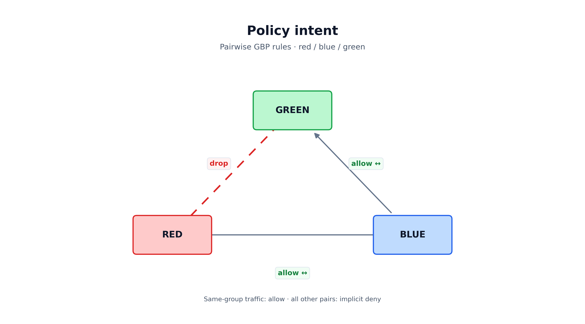

# EDA Microsegmentation — Test Report

**Last updated:** 2026-11-04  
**Current lab:** Talos #2 (k0r4), EDA https://100.124.186.55, namespace `clab-srl-leaf-spine-dcgw` — **§0**  
**Earlier lab (§1–§10):** `3-tier-leaf-spine-dcgw` (clab on WSL), EDA 26.4.2, MS app 6.0.2, namespace `clab-3-tier-leaf-spine-dcgw`  
**Repo:** https://github.com/dtrichards01/eda-microsegmentation-demo  
**Policy intent (all variants):** red↔blue allow, blue↔green allow, red↔green drop, same-group allow. Anything else is dropped only by the explicit catch-all `default deny` entry: **there is no implicit deny** (§0.4).  

{width=6.5in}

**Scope authority:** `docs/VARIANT-SCOPE-LOCK.md` — max **3 leaves** per `vnet-ms-*`; never span all eight leaves.

**Architecture / per-variant guide:** `docs/EDA-Microsegmentation.md` **§2** (EDA intro + variants A–H).

---

## 0. Talos #2 validation (2026-11-04) — current

All eight tests pass on Talos #2: **66 of 66 checks**. The DCI, firewall and tenancy services sharing the lab
keep running, and their regression (`talos/scripts/regression-other-projects.sh`, 18 checks) has 0 failures.
Build files, scripts and transactions: `talos/README.md`.

### 0.1 Common setup

- **Lab:** pod-1 (srl-leaf-1..4) is DC1 and pod-2 (srl-leaf-5..8) is DC2; SR Linux 26.7.1 on 7220 IXR-D2L/D3L.
  DC gateways dcgw-1/2 (DC1) and dcgw-3/4 (DC2) run the existing IPVPN/MPLS DCI.
- **Co-existence:** every client port is Dot1q. The DCI services moved to VLANs 101–105; each test has its own
  VLAN on the same ports, and clients use `eth1.<vlan>` with specific routes only (default routes stay on DCI).
- **Scope:** three leaves in one pod per test (H uses two leaves per DC).
- **Tags:** `ms-red`=5, `ms-blue`=7, `ms-green`=6, `ms-gateway`=4 (D only), Global scope.
- **Rules (all bidirectional):** same colour allow; red↔blue allow; blue↔green allow; red↔green drop (logged);
  final `default deny` on A, B, C, D, F, G. E and H have no default deny (§0.5).
- **Matrix:** six host pings (four allow, two red↔green drop), plus gateway pings where there is a gateway,
  plus two static-route pings in E. H has its own ten checks.

### 0.2 Results

| Test | Pod | What assigns the tag | Policy target | VLAN | Leaves (red / blue / green) | Default deny | Result |
|------|-----|----------------------|---------------|------|-----------------------------|--------------|--------|
| A | 1 | VLAN | VirtualNetwork | 75 | leaf-1 / 2 / 3 | Yes | **8/8** |
| B | 2 | Explicit BridgeInterface | VirtualNetwork | 76 | leaf-5 / 6 / 7 | Yes | **8/8** |
| C | 1 | RoutedInterface (one /24 per colour) | VirtualNetwork | 80 | leaf-1 / 2 / 4 | Yes | **8/8** |
| D | 1 | IRB (gateway) + VLAN | VirtualNetwork | 85 | leaf-4 / 2 / 3 | Yes | **8/8** |
| E | 2 | StaticRoute + VLAN | VirtualNetwork | 90 | leaf-8 / 6 / 7 | No | **10/10** |
| F | 2 | VLAN (one /24 per colour) | Router only | 100 | leaf-5 / 6 / 8 | Yes | **8/8** |
| G | 2 | VLAN, L2 only | BridgeDomain only | 110 | leaf-5 / 7 / 8 | Yes | **6/6** |
| H | 1 + 2 | VLAN, two VNETs joined over the DCI | Both VirtualNetworks | 120 | DC1 red leaf-1, green leaf-3; DC2 blue leaf-5, green leaf-7 | No | **10/10** |

Per-test build:

- **A** `vnet-ms-vlan`: 172.16.75.0/24, gateway .254; client-1 red, client-2 blue, client-3 green.
- **B** `vnet-ms-bridge`: 172.16.76.0/24, gateway .254; explicitly named bridge interfaces `bi-ms-red/blue/green`
  (client-5, 6, 7) are tagged.
- **C** `vnet-ms-routed`: pure L3 handoff, no bridge domain. Red 172.16.80.0/24 (client-1), blue .81 (client-2),
  green .82 (client-4); gateway .1, client .10. The routed interfaces are tagged.
- **D** `vnet-ms-irb`: 172.16.85.0/24, gateway .254. The IRB is tagged `ms-gateway`, the clients (client-4 red,
  client-2 blue, client-3 green) through VLANs; the policy adds "each colour ↔ gateway: allow".
- **E** `vnet-ms-static`: 172.16.90.0/24, gateway .254; client-8 red, client-6 blue, client-7 green. Static route
  172.16.91.0/24 points at client-7 (a real next hop, answering on 172.16.91.1) and is tagged green. Blue reaching
  172.16.91.1 while red is dropped proves the static route's tag is enforced.
- **F** `vnet-ms-enf-router`: policy on the router only, so traffic must be routed to be filtered: one subnet per
  colour, red 172.16.140.0/24 (client-5), blue .141 (client-6), green .142 (client-8), gateway .254.
- **G** `vnet-ms-enf-bd`: L2 only (no router or gateway), 172.16.110.0/24; client-5 red, client-7 blue, client-8
  green. Policy on the bridge domain only.
- **H** `vnet-ms-dci-1` (DC1, 172.16.120.0/24: client-1 red, client-3 green) and `vnet-ms-dci-2` (DC2,
  172.16.121.0/24: client-5 blue, client-7 green), gateways .254. Each VNET's router is joined to the other DC by
  a RouterInterconnect on its DC gateway pair (IPVPN over SR-ISIS, route targets 4190/4191), modelled on
  vnet-1/vnet-2. The IRBs publish per-host routes (`hostRoutePopulate.dynamic`), so blue and green can share the
  DC2 subnet with different tags.

H checks: red→blue, green→blue, green→green and blue→red across the DCI allowed; red→green and green→red across
the DCI dropped; red→green within DC1 dropped; blue→green within DC2 allowed; both gateways reachable.

### 0.3 Root cause of the earlier C failure: `lpm-source-lookup` was never active

SR Linux does not carry group tags in the VXLAN header on this platform. Each leaf works out both tags from its
own tables, which are filled from the EVPN `gbp-tag` community (`add-community` / `install-from-community`):

- **Bridged traffic:** both tags come from the MAC table.
- **Routed traffic:** the destination tag comes from the route; the source tag comes from the MAC table (local
  hosts only) or from an LPM lookup of the source IP. The LPM lookup needs
  `platform resource-management group-based-policy lpm-source-lookup true` **and a chassis reboot**.

EDA configured `lpm-source-lookup true` on every leaf, but live state showed `lpm-source-lookup false` with
`chassis-reboot-required true`: it had never been activated. Routed packets arriving at the receiving leaf
therefore had source tag 0 and hit `default deny`. That is why C failed here first (and on WSL, §6), and why the
first workaround was removing C's default deny (transaction 136225).

All eight leaves were rebooted one at a time with `talos/scripts/leaf-reboot.sh` (procedure in `talos/README.md`).
After each reboot A–G and the regression passed. Afterwards the default deny went back on C and F (transaction
136806), and both pass with it.

### 0.4 Enforcement behaviour verified with counters

- **No implicit deny.** With G's blue↔green allow rule and its default deny both removed (transaction 136682),
  blue↔green pings passed while the red↔green drop still worked. Neither EDA nor SR Linux has a default-action
  setting; the explicit `default deny` entry is what blocks unlisted pairs. G was restored straight away (136683).
- **Where the ACL applies.** The GBP ACL applies to packets entering any subinterface of the network-instance,
  including packets arriving from VXLAN, so both the sending and the receiving leaf evaluate traffic.
- **What bypasses it.** BUM traffic and traffic extracted to the CPU (ARP, pings to IRB or gateway addresses) are
  not filtered, so gateway pings prove reachability, not policy.

### 0.5 Where a default deny does not work

- **E (static route to a real next hop).** With the default deny, blue→172.16.91.1 was dropped. The sending leaf
  (leaf-6) routes the packet to next hop client-7 in the same bridge domain and sends it bridged, with leaf-6's IRB
  MAC as source. leaf-7 takes the source tag from its MAC table, where that IRB MAC has tag 0, so `default deny`
  drops it. `lpm-source-lookup` does not help, because bridged packets use the MAC table. E keeps no default deny
  (transaction 136818); red→172.16.91.1 is still dropped by the explicit red↔green rule.
- **H (cross-DC).** H has no default deny so that the result shows only whether tags survive the DC gateways. It
  passes because they do: see §0.6.

### 0.6 Cross-DC (H): tags survive the IPVPN gateways

The DC gateways run no group-based policy, yet the `gbp-tag` community survives their EVPN → IPVPN → EVPN
re-origination. leaf-7 in DC2 learns DC1's hosts as `/32` routes with their tags (172.16.120.1 tag 5 red,
172.16.120.3 tag 6 green), and DC1 sees DC2's hosts the same way.

Red→green across the DCI is therefore dropped **on the sending leaf**: ten pings from client-1 to client-7 raised
"block red to/from green" in leaf-1's `router-ms-dci-1` ACL by exactly 10, and leaf-7 saw none of them. Per-host
routes are needed because a shared subnet carries a single tag; without `hostRoutePopulate.dynamic` the remote
side would only see an untagged /24.

### 0.7 Talos-specific notes

- Never move a client's default route: DCI owns it. Tests use specific routes on `eth1.<vlan>`.
- Each test's label key is unique per DC (`ms-dci1`, `ms-dci2`) so a VLAN selector never lands on the other DC.
- RouterInterconnect RDs are `<router AS>:<assigned number>`, so H's routers have their own AS (65471, 65481).
- Containerlab leaf reboots need the repair steps in `talos/README.md`; a bare `docker start` leaves links down and
  the node NotSynced.

### 0.8 Evidence: GBP tags are carried in the BGP control plane

Group tags travel as the `gbp-tag:0:N` extended community on EVPN routes (and IPVPN routes between DCs). Each
leaf installs the tag into its MAC table (type-2) or route table (type-5), and the ACL looks up the source tag
there. Per SR Linux documentation the tag is not carried in the VXLAN header on this platform. The lab behaves
accordingly (H drops on the sending leaf, §0.6), but this was not confirmed with a packet capture. Group map:
ms-red = 5, ms-green = 6, ms-blue = 7. The full raw output is in `talos/evidence/`.

**Same pod, EVPN type-2 (leaf-8 receiving client-5, red).** Command:
`show network-instance default protocols bgp routes evpn route-type 2 detail`

```text
Route Distinguisher: 11.0.0.12:4152
MAC address        : AA:C1:AB:C4:38:9F
IP Address         : 172.16.140.5
neighbor           : 11.0.0.13            (same path via 11.0.0.14)
    BGP next-hop          : 11.0.0.12
    Communities           : [target:1:4152, target:1:4151, gbp-tag:0:5, mac-nh:1a:6f:13:ff:00:00, bgp-tunnel-encap:VXLAN]
```

The MAC table that route fills (`show network-instance bd-ms-enf-bd bridge-table mac-table all`). leaf-8 has no
local config that would tag this remote MAC, so the tag comes from the route:

```text
| AA:C1:AB:C4:38: | vxlan-interface:vxlan0.530 vtep:11.0.0.12 | 10187282 | evpn | true | N/A | none | 5 (ms-red) | ...
```

**Cross-DC (H), hop by hop for client-1 172.16.120.1/32 (red).**

1. EVPN type-5 from leaf-1, as received at dcgw-1 (RD `11.0.0.4:4171`):
   `Communities: [target:1:4171, gbp-tag:0:5, mac-nh:..., bgp-tunnel-encap:VXLAN]`
2. Re-originated as IPVPN across the WAN, at dcgw-3
   (`show ... bgp routes l3vpn-ipv4-unicast prefix 172.16.120.1/32`, RD `65471:2`, from 11.0.0.7):
   `Communities: target:1:4190, gbp-tag:0:5`
3. Re-originated as EVPN type-5 into DC2, at leaf-7 (RD `11.0.2.3:4181`, next hop dcgw-3):
   `Communities: [target:1:4181, mac-nh:1a:0f:0a:ff:00:00, bgp-tunnel-encap:VXLAN, gbp-tag:0:5]`,
   `Domain Path: 65000:104, 65000:203`
4. Installed on leaf-7 (`info flat from state network-instance * route-table ipv4-unicast`):

```text
router-ms-dci-2 route 172.16.120.1/32 route-type bgp-evpn         group-based-policy-tag 5   (client-1, red,   DC1)
router-ms-dci-2 route 172.16.120.3/32 route-type bgp-evpn         group-based-policy-tag 6   (client-3, green, DC1)
router-ms-dci-2 route 172.16.121.5/32 route-type bgp-evpn-ifl-host group-based-policy-tag 7  (client-5, blue,  DC2)
router-ms-dci-2 route 172.16.121.7/32 route-type arp-nd           group-based-policy-tag 6   (client-7, green, local)
```

The DC gateways have no group-based policy config, yet the community is preserved through
EVPN → IPVPN → EVPN. The dcgw-3 IPVPN table holds a per-host `/32` for each H client (`.120.1`, `.120.3` under
RD `65471:2`; `.121.5`, `.121.7` under RD `65481:2`) alongside the `/24`s. Those per-host routes come from
`hostRoutePopulate.dynamic` on the IRBs and let each host keep its own tag.

### 0.9 Enforcement points: which network-instance drops the packet

The GBP ACL lives in SR Linux network-instances, not on interfaces. The policy target decides which instances get it:

- **VirtualNetwork target (A–E, H):** the same ACL goes into both the bridge domain (mac-vrf, `bd-ms-*`) and the
  router (ip-vrf, `router-ms-*`) on every leaf in scope.
- **Router target (F):** only `router-ms-enf-router` has the ACL; the per-colour bridge domains
  (`bd-ms-enf-router-red/blue/green`) have none and only carry the tags.
- **BridgeDomain target (G):** only `bd-ms-enf-bd`; there is no router.
- **C** has no bridge domain, so the router is the only place it can enforce.

A packet is checked by the first network-instance it enters that holds the ACL. Bridged (same subnet) traffic is
dropped in the bridge domain. Routed traffic is dropped in the router. The IRB has no ACL of its own: it is the
router's subinterface, so a routed packet enters the router through it and the router's ACL acts there. The
association target (VLAN, BridgeInterface, IRB…) only decides which tag an endpoint gets.

Verified with `talos/scripts/gbp-trace.sh`, which runs 10 red→green pings per test and reports which ACL counters
on the sending and receiving leaves increased (raw output: `talos/evidence/cap-enforcement-trace.txt`):

| Test | Path | Dropped by |
|------|------|------------|
| A (VLAN) | Bridged | leaf-1 `bd-ms-vlan` entry 55 "block red to/from green", +10 |
| B (BridgeInterface) | Bridged | leaf-5 `bd-ms-bridge` entry 55, +10 |
| C (RoutedInterface) | Routed, no bridge domain | leaf-1 `router-ms-routed` entry 55, +10 |
| D (IRB + VLAN) | Bridged | leaf-4 `bd-ms-irb` entry 85, +10 |
| E hosts | Bridged | leaf-8 `bd-ms-static` entry 55, +10 |
| E static route (172.16.91.1) | Routed | leaf-8 `router-ms-static` entry 55, +10 |
| F (policy on Router) | Routed | leaf-5 `router-ms-enf-router` entry 55, +10 |
| G (policy on BridgeDomain) | Bridged | leaf-5 `bd-ms-enf-bd` entry 55, +9; leaf-8 `bd-ms-enf-bd` "default deny", +1 |
| H (across DCs) | Routed over the DCI | leaf-1 `router-ms-dci-1` entry 55, +10 |

Every drop happens on the **sending leaf**; no receiving leaf counted a red↔green drop, apart from one G packet.
That packet was reproduced (`talos/evidence/cap-g-first-packet.txt`). With G idle long enough for its MAC
entries (300 s aging) and the clients' ARP entries to expire, one ping raised leaf-8's "default deny" by 1 and
nothing on leaf-5; five more pings raised leaf-5's red↔green entry by 5. The first packet gets past leaf-5's ACL
and reaches leaf-8 with source tag 0, which fits it being flooded as unknown unicast (flooded traffic bypasses the
ACL) before the new EVPN type-2 routes arrive. The flooding itself happens within milliseconds and was not
captured. Without a default deny, that one cold red→green packet would be delivered.

D's client-to-client drops are in the bridge domain, not at the IRB: red and green share 172.16.85.0/24, so
their traffic is never routed. D's IRB tag (`ms-gateway`) only matters for traffic addressed to the gateway, and
pings to the gateway are extracted to the CPU and bypass the ACL (§0.4).

---

## 1. Executive summary — WSL lab (2026-08-20)

| Variant | Scope | Association | Status | Notes |
|---------|-------|-------------|--------|-------|
| **A** VLAN | leaf-1/2/3 | VLAN | **Validated** | July 2026 baseline |
| **B** BridgeInterface | leaf-5/6/7 | BridgeInterface (explicit BI names) | **Validated** | |
| **C** RoutedIF | leaf-5/6/7 | RoutedInterface | **Failed** (under investigation) | Policy on → all cross-subnet fails |
| **D** IRB | leaf-2/3/4 | IRB + VLAN helpers | **Validated** | Full GBP matrix after 4-entry `ms-assoc-irb` |
| **E** StaticRoute | leaf-6/7/8 | StaticRoute + VLAN | **Validated** | Prefix deny via blackhole route — not tested to actual remote host |
| **F** Router enf. | leaf-5/6/7 | VLAN | **Not currently validated** | |
| **G** BD enf. | leaf-5/6/7 | VLAN | **Not currently validated** | L2 only |

**Key findings (Aug 2026):**

1. **Variant D** requires **both** `irb-ms-irb`→gateway **and** VLAN→red/blue/green in `ms-assoc-irb`. IRB-only association blocks all inter-host traffic; gateway ping still works.
2. **Variant E** tags `172.16.91.0/24` green via `static-remote-green` (blackhole); client tags via VLAN; standard host matrix + prefix deny validated.
3. **Never** use `nodeSelectors: [eda.nokia.com/role=leaf]` on MS demo routers — causes 8-leaf scope blowout.
4. **Never** apply full `variants/edge-interfaces-dot1q.yaml` — use scoped label snippets only.

Apply bundles: `variants/_variant-d-leaf234-apply.yaml`, `variants/_variant-e-leaf678-apply.yaml`.

---

## 2. Test environment (current)

### Scoped client ↔ leaf mapping (validated)

| Phase | Client | Leaf | Colour | Interface | Subnet / VLAN |
|-------|--------|------|--------|-----------|---------------|
| **D** | client2 | leaf-2 | blue | `eth1.85` | `172.16.85.2/24` |
| **D** | client3 | leaf-3 | green | `eth1.85` | `172.16.85.3/24` |
| **D** | client4 | leaf-4 | red | `eth1.85` | `172.16.85.4/24` |
| **E** | client6 | leaf-6 | blue | `eth1.90` | `172.16.90.6/24` |
| **E** | client7 | leaf-7 | green | `eth1.90` | `172.16.90.7/24` |
| **E** | client8 | leaf-8 | red | `eth1.90` | `172.16.90.8/24` |

Gateways: D `172.16.85.254`, E `172.16.90.254`. Client IP last octet = client number.

Docker container names: `clientN` (not `clab-*-clientN`) in WSL clab.

### Variant catalog (Dot1q VLAN IDs — current manifests)

| ID | VLAN | VirtualNetwork | AssociationPolicy | MicroSegmentationPolicy |
|----|------|----------------|-------------------|-------------------------|
| A | 75 | `vnet-ms-vlan` | `ms-assoc-vlan` | `ms-policy-vlan` |
| B | 75 | `vnet-ms-bridge` | `ms-assoc-bridge` | `ms-policy-bridge` |
| C | 80/81/82 | `vnet-ms-routed` | `ms-assoc-routed` | `ms-policy-routed` |
| D | 85 | `vnet-ms-irb` | `ms-assoc-irb` | `ms-policy-irb` |
| E | 90 | `vnet-ms-static` | `ms-assoc-static` | `ms-policy-static` |
| F | 100 | `vnet-ms-enf-router` | `ms-assoc-enf-router` | `ms-policy-enf-router` |
| G | 110 | `vnet-ms-enf-bd` | `ms-assoc-enf-bd` | `ms-policy-enf-bd` |

---

## 3. Test method

1. **Labels:** leaf-scoped Interface CR labels (`variants/labels-vnet-ms-irb.yaml` or `labels-vnet-ms-static.yaml`).
2. **Apply:** scoped apply bundle (not full `virtualnetworks.yaml` without scope review).
3. **Pre-apply gate:** `kubectl get virtualnetwork <vn> -o jsonpath='{.status.nodes}'` ⊆ allowed leaves (3 max).
4. **Clients:** `scripts/configure-client-ms-eth1.py --variant D|E --apply` or manual `eth1.<vlan>`.
5. **Ping:** `docker exec clientN ping -I eth1.<vlan> -c 3 -W 2 <dest>`.
6. **Pass criteria:** Allow = 0% loss; Drop = 100% loss.

Automated: `python3 scripts/run-ms-tests.py D E`

---

## 4. Results — Variant D (2026-08-20, **GO**)

**Service:** `vnet-ms-irb` on **leaf-2, leaf-3, leaf-4** only (`numNodes: 3`, `operationalState: Up`).

**Association (`ms-assoc-irb`):**

| Target | GroupTag |
|--------|----------|
| `irb-ms-irb` | gateway |
| `vlan-ms-irb-red` | red |
| `vlan-ms-irb-blue` | blue |
| `vlan-ms-irb-green` | green |

**Enforcement:** `ms-policy-irb` → `virtualNetworks: [vnet-ms-irb]`. L3 decisions at IRB; VLAN entries classify clients at ingress.

| Test | From → To | Expected | Result |
|------|-----------|----------|--------|
| red → blue | client4 → `172.16.85.2` | Allow | **PASS** (3/3) |
| red → green | client4 → `172.16.85.3` | Drop | **PASS** (0/3) |
| blue → green | client2 → `172.16.85.3` | Allow | **PASS** (3/3) |
| blue → red | client2 → `172.16.85.4` | Allow | **PASS** (3/3) |
| green → blue | client3 → `172.16.85.2` | Allow | **PASS** (3/3) |
| green → red | client3 → `172.16.85.4` | Drop | **PASS** (0/3) |
| → gateway | all → `172.16.85.254` | Allow | **PASS** (3/3 each) |

**Failure mode (earlier same day):** IRB-only association (gateway entry without VLAN helpers) → all inter-host ALLOW paths failed; gateway ping passed. Fixed by restoring 4-entry association.

---

## 5. Results — Variant E (2026-08-20, **GO**)

**Service:** `vnet-ms-static` on **leaf-6, leaf-7, leaf-8** only (`numNodes: 3`, `operationalState: Up`).

**Association (`ms-assoc-static`):**

| Target | GroupTag |
|--------|----------|
| `static-remote-green` | green (prefix `172.16.91.0/24`, blackhole) |
| `vlan-ms-static-red` | red |
| `vlan-ms-static-blue` | blue |
| `vlan-ms-static-green` | green |

**Enforcement:** `ms-policy-static` → `virtualNetworks: [vnet-ms-static]`.

| Test | From → To | Expected | Result |
|------|-----------|----------|--------|
| red → blue | client8 → `172.16.90.6` | Allow | **PASS** (3/3) |
| red → green | client8 → `172.16.90.7` | Drop | **PASS** (0/3) |
| blue → green | client6 → `172.16.90.7` | Allow | **PASS** (3/3) |
| blue → red | client6 → `172.16.90.8` | Allow | **PASS** (3/3) |
| green → blue | client7 → `172.16.90.6` | Allow | **PASS** (3/3) |
| green → red | client7 → `172.16.90.8` | Drop | **PASS** (0/3) |
| blue → gateway | client6 → `172.16.90.254` | Allow | **PASS** (3/3) |
| red → static prefix | client8 → `172.16.91.1` | Drop | **PASS** (0/3) |

Static-route test: destination tagged **green** via `static-remote-green`; red↔green policy drops even though prefix is blackhole.

---

## 6. Variant C — parked (2026-08-20)

**Symptom:** Phase 1 (no `ms-policy-routed`) — cross-subnet pings pass. Phase 2 (policy on) — **all** cross-subnet fails, including red→blue Allow.

**Conclusion (superseded 2026-11-04):** not a platform limitation. The leaves had `lpm-source-lookup` configured but not activated (it needs a chassis reboot), so routed packets reached the receiving leaf with source tag 0 and hit the default deny. Fixed on Talos #2 by rebooting the leaves; C passes 8/8 with the default deny (§0.3).

Details: `docs/tmp/variant-c-policy-fix-20260820-120141/SUMMARY.md`

---

## 7. Summary matrix (Aug 2026 validation)

| Variant | Scope | EDA Up (3 nodes) | GBP matrix | Policy verified? |
|---------|-------|------------------|------------|------------------|
| **D** IRB | leaf-2/3/4 | Yes | **Pass** | **Yes** |
| **E** StaticRoute | leaf-6/7/8 | Yes | **Pass** | **Yes** |
| **C** RoutedIF | leaf-5/6/7 | Yes | Fail (with policy) | **Parked** |
| A–B, F–G | catalog | — | Not re-run Aug 2026 | See §8 |

---

## 8. Historical run (2026-07-31) — superseded for D/E

An earlier automated run used VLAN **101–108** on `eth1.101`–`eth1.108`, different client/leaf mapping, and reported **FAIL** for Variants D and E (routing/scope issues). That run predates:

- Scoped 3-leaf apply bundles
- Correct Dot1q VLAN **85** (D) and **90** (E)
- 4-entry `ms-assoc-irb` (VLAN + IRB)
- Removal of `nodeSelectors: role=leaf` on MS routers

Raw JSON (historical): `test-results/test-results-full-2026-07-31-v3.json`

| Variant | Jul 2026 result | Aug 2026 status |
|---------|-----------------|-----------------|
| A VLAN | **Pass** | Still valid baseline |
| B BridgeIF | Fail (EVPN host route) | Not re-tested |
| C RoutedIF | Fail | **Parked** (confirmed Aug) |
| D IRB | Fail | **GO** (scoped re-test) |
| E StaticRoute | Partial | **GO** (scoped re-test) |
| F, G | Fail | Not re-tested |

---

## 9. How to reproduce (current)

```bash
cd /mnt/c/Users/darrenri/Documents/eda-microsegmentation-demo

# Variant D
kubectl apply -f variants/labels-vnet-ms-irb.yaml
kubectl apply -f variants/_variant-d-leaf234-apply.yaml
python3 scripts/configure-client-ms-eth1.py --variant D --apply
python3 scripts/run-ms-tests.py D

# Variant E
kubectl apply -f variants/labels-vnet-ms-static.yaml
kubectl apply -f variants/_variant-e-leaf678-apply.yaml
python3 scripts/configure-client-ms-eth1.py --variant E --apply
python3 scripts/run-ms-tests.py E
```

---

## 10. Conclusions

1. **Variants D and E** validate the full red/blue/green GBP intent on **scoped 3-leaf** deployments (Aug 2026).
2. **Association vs policy:** Association classifies (VLAN, IRB, StaticRoute); policy enforces between GroupTags. Missing VLAN associations on D blocks inter-host traffic even when gateway works.
3. **Variant C** was parked on WSL; the root cause (inactive `lpm-source-lookup`) and fix are in §0.3.
4. **Operational rules:** 3-leaf max, no `role=leaf` router selectors, scoped label files only, pre-apply `status.nodes` gate.

Architecture and per-variant design: `docs/EDA-Microsegmentation.md` §12.4.

**Word exports:** regenerate from markdown with `bash scripts/generate-word-docs.sh` (requires pandoc). Close open `.docx` files in Word before regenerating.

---

*Report updated 2026-11-04 with the Talos #2 validation of A–H (§0). §1–§10 record the WSL lab (Aug 2026).*
