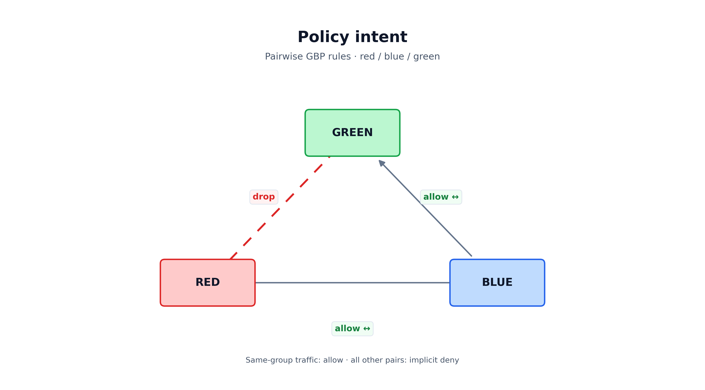
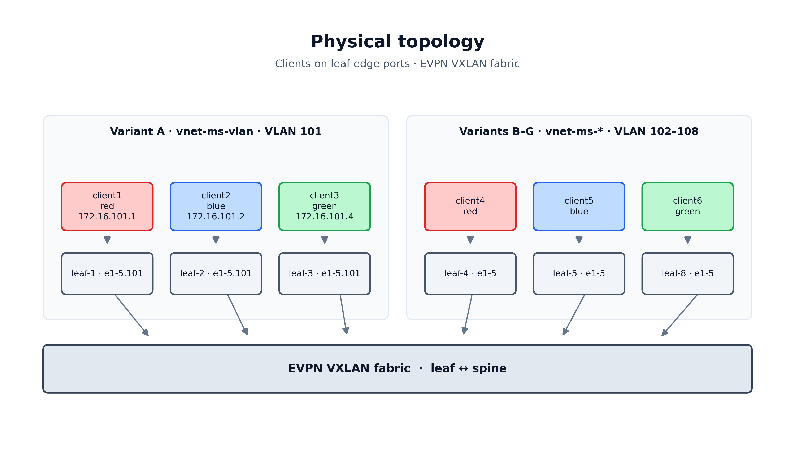
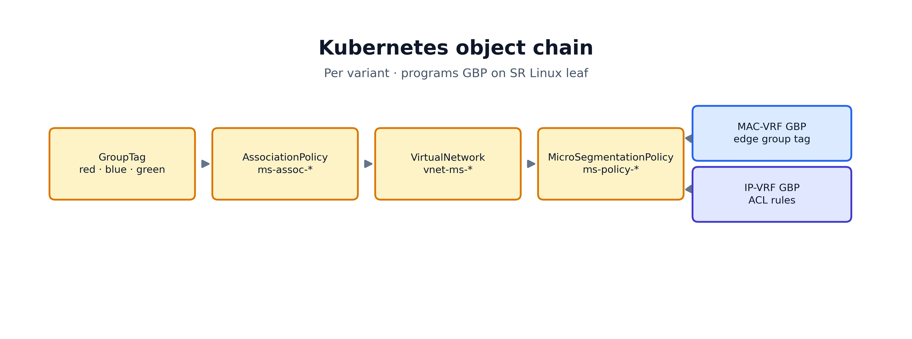
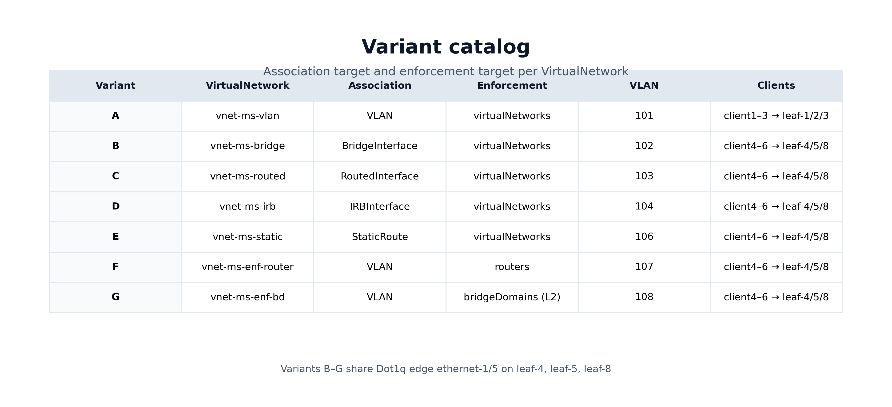
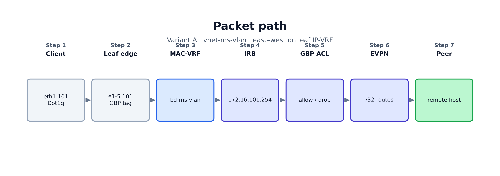

# EDA Microsegmentation

**Environment:** WSL EDA (`kind-eda-demo-wsl2`) — UI https://127.0.0.1:9443  
**EDA release:** 26.4.2  
**Microsegmentation app:** 6.0.2  
**Namespace:** `clab-3-tier-leaf-spine-dcgw`  
**Services:** Seven dedicated `vnet-ms-*` VirtualNetworks (variants A–G), plus cross-DC variant H on Talos #2  
**Current validation:** Talos #2 (EDA https://100.124.186.55, SR Linux 26.7.1), A–H all pass, 2026-11-04 — see `docs/EDA-Microsegmentation-Test-Report.md` §0 and `talos/README.md`

---

## 1. Purpose

This lab demonstrates Nokia EDA microsegmentation on a three-tier leaf–spine fabric. All variants share the same **policy intent**:

- **Red** can talk to **Blue**
- **Blue** can talk to **Green**
- **Red** cannot talk to **Green**
- All other cross-group traffic is dropped by a final catch-all `default deny` entry (zero-trust). There is **no implicit deny**: without that entry, unmatched traffic is forwarded (verified on Talos #2).

On the dataplane, EDA programs **Group-Based Policy (GBP)** on SR Linux **26.3+** (7220 IXR-D2L/D3L leaf platforms).

{width=6.5in}

The diagram uses a **triangle** layout: each edge is one pairwise relationship — allow on red↔blue and blue↔green, drop on red↔green.

---

## 2. Microsegmentation overview and lab variants

### 2.1 What is microsegmentation?

Nokia EDA **microsegmentation** applies **zero-trust** security inside the network, not only at the perimeter. Instead of one trusted "inside" zone, the service is split into **segments** — endpoints with the same security posture grouped under a **GroupTag**. **East–west** traffic (between internal hosts) is controlled by ordered allow/deny rules between source and destination groups.

Policies reference **GroupTags**, not fixed VLAN IDs or IP addresses, so rule intent stays stable when VLANs, subnets, or attachment points change.

On the dataplane, EDA programs **Group-Based Policy (GBP)** on Nokia SR Linux (**26.3+**) on **7220 IXR-D2L/D3L** leaf platforms (EDA also documents **7220 IXR-D4** for L2-only use cases).

**EDA references:**

- [Micro Segmentation Application](https://docs.eda.dev/latest/apps/microsegmentation.eda.nokia.com/docs/)
- [MicroSegmentationPolicy](https://docs.eda.dev/latest/apps/microsegmentation.eda.nokia.com/docs/resources/microsegmentationpolicy/)
- [AssociationPolicy](https://docs.eda.dev/26.4/apps/microsegmentation.eda.nokia.com/resources/associationpolicy/)
- [GroupTag](https://docs.eda.dev/latest/apps/microsegmentation.eda.nokia.com/docs/resources/grouptag/)

### 2.2 How EDA implements it — classify then enforce

EDA microsegmentation uses **two independent choices**:

| Step | Kubernetes CR | Question it answers |
|------|-----------------|---------------------|
| **1. Classify** | `AssociationPolicy` | *Which GroupTag does this endpoint or prefix carry?* |
| **2. Enforce** | `MicroSegmentationPolicy` | *Which source→destination GroupTag pairs are allowed or denied, and where is GBP applied?* |

**Association** binds GroupTags to `associationTargets`: VLAN, BridgeInterface, RoutedInterface, IRBInterface, or StaticRoute.

**Enforcement** applies ordered `policyEntries` to `serviceTargets`: `virtualNetworks`, `routers`, or `bridgeDomains`.

**Important:** Association does **not** equal enforcement. Extra association entries (for example VLAN helpers in Variant D, or a static route in Variant E) supply **tags**; they do not by themselves move the filter to L2 unless enforcement targets `bridgeDomains` (Variant G).

Workflow (from EDA docs):

1. Create **GroupTags** (segments).
2. Create **AssociationPolicy** — bind tags to network resources.
3. Create **MicroSegmentationPolicy** — match source/dest GroupTags and apply actions on service targets.

### 2.3 Lab topology (all variants)

Each variant is a **separate** `vnet-ms-*` VirtualNetwork on up to **three leaves**. Authoritative scope: `docs/VARIANT-SCOPE-LOCK.md`.

{width=6.5in}

{width=6.5in}

{width=8in}

| ID | VirtualNetwork | Association | Enforcement |
|----|----------------|-------------|-------------|
| A | `vnet-ms-vlan` | VLAN | `virtualNetworks` |
| B | `vnet-ms-bridge` | BridgeInterface | `virtualNetworks` |
| C | `vnet-ms-routed` | RoutedInterface | `virtualNetworks` |
| D | `vnet-ms-irb` | IRBInterface + VLAN | `virtualNetworks` |
| E | `vnet-ms-static` | StaticRoute + VLAN | `virtualNetworks` |
| F | `vnet-ms-enf-router` | VLAN | `routers` |
| G | `vnet-ms-enf-bd` | VLAN | `bridgeDomains` |

### 2.4 Variant A — VLAN association (`vnet-ms-vlan`)

| Item | Detail |
|------|--------|
| **Used for** | Baseline model: classify clients by **VLAN membership** in the service bridge domain. |
| **Association** | `ms-assoc-vlan` maps `vlan-ms-vlan-red` / `-blue` / `-green` → red / blue / green. |
| **Enforcement** | `ms-policy-vlan` → `serviceTargets.virtualNetworks: [vnet-ms-vlan]`. GBP on the **VirtualNetwork** (L2 edge tagging + L3 IRB forwarding path). |
| **Service** | Single subnet `172.16.75.0/24`, IRB `172.16.75.254`, VLAN **75**, symmetric IRB (`rfc9135SymmetricMode`). |
| **Scope (catalog)** | leaf-1/2/3, client1/2/3. |
| **Status** | **Validated** |

**What it proves:** GroupTags programmed from **VLAN objects**; east–west filtering on a shared L3 gateway subnet.

### 2.5 Variant B — BridgeInterface association (`vnet-ms-bridge`)

| Item | Detail |
|------|--------|
| **Used for** | Classify at the **BridgeInterface CR** (dot1q subinterface object) instead of the VLAN CR. |
| **Association** | `ms-assoc-bridge` must use **explicit** `bridgeInterfaces: [bi-red-5, bi-blue-6, bi-green-7]`. Label selectors on parent `Interface` CRs did **not** program GBP on `ethernet-1/5.75` in lab testing. |
| **Enforcement** | `ms-policy-bridge` → `virtualNetworks: [vnet-ms-bridge]`. |
| **Service** | Same subnet pattern as A (`172.16.75.0/24`), VLAN **75**. |
| **Scope (catalog)** | leaf-5/6/7, client4/5/6. |
| **Status** | **Validated** |

**What it proves:** Association target type **BridgeInterface** works when named explicitly; selector indirection is unreliable on access subifs.

### 2.6 Variant C — RoutedInterface association (`vnet-ms-routed`)

| Item | Detail |
|------|--------|
| **Used for** | Classify at **L3 routed handoff** — each colour gets its own routed subinterface and subnet on the leaf. |
| **Association** | `ms-assoc-routed` → `ri-red-5`, `ri-blue-6`, `ri-green-7`. |
| **Enforcement** | `ms-policy-routed` → `virtualNetworks: [vnet-ms-routed]`. |
| **Service** | Per-leaf gateways: `172.16.80.1/24`, `.81.1/24`, `.82.1/24`; VLANs **80/81/82**. No shared IRB subnet. |
| **Scope (catalog)** | leaf-5/6/7. |
| **Status** | **Validated on Talos #2** (2026-11-04, 8/8 with default deny). The earlier failure (WSL, and Talos before the fix) was not a platform limitation: `lpm-source-lookup` was configured but not active until a leaf reboot, so routed packets reached the far leaf with source tag 0 and hit the default deny. See **§2.12**. |

### 2.7 Variant D — IRB + VLAN association (`vnet-ms-irb`)

| Item | Detail |
|------|--------|
| **Used for** | Tagging the **gateway (IRB)** as its own group alongside VLAN-tagged clients. |
| **Association** | `ms-assoc-irb`: `irb-ms-irb` → **gateway**; `vlan-ms-irb-red/blue/green` → red/blue/green. **All four entries required.** |
| **Enforcement** | `ms-policy-irb` → `virtualNetworks: [vnet-ms-irb]`. The ACL is in both `bd-ms-irb` and `router-ms-irb`; client-to-client drops happen in the **bridge domain** on the sending leaf (shared subnet, never routed). Verified with counters: Test Report §0.9. |
| **Service** | `172.16.85.0/24`, IRB `172.16.85.254`, VLAN **85**. |
| **Scope (validated)** | **leaf-2=blue**, **leaf-3=green**, **leaf-4=red** — client2/3/4, IPs `172.16.85.2/3/4`. Apply: `variants/_variant-d-leaf234-apply.yaml`. |
| **Status** | **Validated** (2026-08-20). |

**What it proves:** An IRB can be an association target (gateway tag) next to VLAN-tagged clients; IRB-only association (gateway tag alone) is **insufficient** — client VLAN associations required. Tagging the IRB does not move enforcement to the IRB.

### 2.8 Variant E — StaticRoute + VLAN association (`vnet-ms-static`)

| Item | Detail |
|------|--------|
| **Used for** | **Prefix-based destination classification**: remote prefix tagged via StaticRoute; clients tagged via VLAN. |
| **Association** | `ms-assoc-static`: `static-remote-green` → **green** for prefix `172.16.91.0/24` (blackhole nexthop); VLAN objects → red/blue/green for clients. |
| **Enforcement** | `ms-policy-static` → `virtualNetworks: [vnet-ms-static]`. Standard host matrix; static route supplies **destination** tag for remote prefix traffic. |
| **Service** | `172.16.90.0/24`, IRB `172.16.90.254`, VLAN **90**. |
| **Scope (validated)** | **leaf-6=blue**, **leaf-7=green**, **leaf-8=red** — client6/7/8, IPs `172.16.90.6/7/8`. Apply: `variants/_variant-e-leaf678-apply.yaml`. |
| **Extra test** | red → `172.16.91.1` **deny** (dest classified green via static route, red↔green blocked). |
| **Status** | **Validated** (WSL 2026-08-20 with a blackhole route; Talos #2 2026-11-04, 10/10, with a real next hop: client-7 answers on `172.16.91.1`). On Talos E has **no default deny**: traffic to the static prefix is routed and then bridged to the next hop with the sending leaf's IRB MAC as source, which has tag 0 in the next-hop leaf's MAC table. |

**What it proves:** GroupTags can bind to **StaticRoute** prefixes, not only VLAN/BI/RI/IRB objects.

### 2.9 Variant F — Router enforcement target (`vnet-ms-enf-router`)

| Item | Detail |
|------|--------|
| **Used for** | Same VLAN client tagging as A; differs in **where GBP is anchored**. |
| **Association** | `ms-assoc-enf-router` → `vlan-enf-router-red/blue/green`. |
| **Enforcement** | `ms-policy-enf-router` → **`serviceTargets.routers: [router-ms-enf-router]`** (not `virtualNetworks`). |
| **Service** | `172.16.100.0/24`, VLAN **100**. |
| **Scope (catalog)** | leaf-5/6/7. |
| **Status** | **Validated on Talos #2** (2026-11-04, 8/8). Enforcing on the router filters only routed traffic, so Talos uses one subnet per colour (`172.16.140/141/142.0/24`); a shared subnet would never be filtered. |

**What it proves:** Enforcement anchor can be the **router CR** rather than the whole VirtualNetwork.

### 2.10 Variant G — BridgeDomain enforcement target (`vnet-ms-enf-bd`)

| Item | Detail |
|------|--------|
| **Used for** | **L2-only** microsegmentation — no IRB/router; GBP on the **bridge domain** (MAC-VRF). |
| **Association** | `ms-assoc-enf-bd` → `vlan-enf-bd-red/blue/green`. |
| **Enforcement** | `ms-policy-enf-bd` → **`serviceTargets.bridgeDomains: [bd-ms-enf-bd]`**. |
| **Service** | VLAN **110**, no L3 gateway on clients. |
| **Scope (catalog)** | leaf-5/6/7. |
| **Status** | **Validated on Talos #2** (2026-11-04, 6/6). |

**What it proves:** Pure L2 microsegmentation with enforcement on **bridgeDomains**; hosts have no default route.

### 2.11 Variant H — cross-DC (`vnet-ms-dci-1` + `vnet-ms-dci-2`, Talos #2 only)

| Item | Detail |
|------|--------|
| **Used for** | Enforcing the same matrix between two data centres joined by an IPVPN/MPLS DCI. |
| **Association** | `ms-assoc-dci`: VLANs in both DCs → red / blue / green. |
| **Enforcement** | `ms-policy-dci` → `virtualNetworks: [vnet-ms-dci-1, vnet-ms-dci-2]`, no default deny. |
| **Service** | DC1 `172.16.120.0/24` (red leaf-1, green leaf-3), DC2 `172.16.121.0/24` (blue leaf-5, green leaf-7), VLAN **120**. Each router is joined to the other DC by a `RouterInterconnect` on its DC gateway pair (IPVPN over SR-ISIS), like vnet-1/vnet-2. IRBs use `hostRoutePopulate.dynamic` so each host is advertised as a tagged `/32`. |
| **Status** | **Validated on Talos #2** (2026-11-04, 10/10). |

**What it proves:** The `gbp-tag` community survives the DC gateways' EVPN → IPVPN → EVPN re-origination, even though the gateways run no group-based policy. The sending leaf learns the remote host's tag and drops red → green before the traffic crosses the DCI. Per-host routes are required when colours share a subnet, because a subnet route carries one tag.

### 2.12 Platform prerequisite — `lpm-source-lookup` needs a reboot

SR Linux does not carry group tags in the VXLAN header here; each leaf derives both tags from its own tables (MAC table for bridged traffic; route table plus MAC table for routed traffic). For a **routed** packet arriving from VXLAN, the source tag comes from an LPM lookup of the source IP, enabled by `platform resource-management group-based-policy lpm-source-lookup true`. EDA configures it, but it only takes effect after a **chassis reboot**:

```bash
info from state platform resource-management group-based-policy
# want: lpm-source-lookup true, chassis-reboot-required false
```

Until then, a final `default deny` drops allowed routed traffic (C, F). In containerlab a reboot needs link and client repair: `talos/scripts/leaf-reboot.sh` and `talos/README.md`.

**Scope lock:** Never span all eight leaves in one `vnet-ms-*`. Never `nodeSelectors: [eda.nokia.com/role=leaf]` on MS demo routers. See `docs/VARIANT-SCOPE-LOCK.md`.

---

## 3. The four Kubernetes objects

These four CR types appear in every variant. Examples below use **Variant A** unless noted.

### 3.1 GroupTag

Defines logical segments: `red`, `blue`, `green`.

| Field | Value |
|-------|--------|
| API | `microsegmentation.eda.nokia.com/v1alpha1` |
| Kind | `GroupTag` |
| Scope | `Local` (per VirtualNetwork scope; IDs from `group-tag-pool-local`) |

A GroupTag names a segment with an identical security posture. EDA allocates Group Tag IDs from `group-tag-pool-global` or `group-tag-pool-local` depending on scope.

### 3.2 AssociationPolicy

Maps GroupTags to **network resources** inside each `vnet-ms-*` service.

**Variant A example** (`ms-assoc-vlan` on `vnet-ms-vlan`):

| VLAN object | GroupTag |
|-------------|----------|
| `vlan-ms-vlan-red` | red |
| `vlan-ms-vlan-blue` | blue |
| `vlan-ms-vlan-green` | green |

EDA associates the tag with the **VLAN + bridge attachment** so SRL programs GBP on the edge subinterface.

Association targets supported in this lab: VLAN, BridgeInterface, RoutedInterface, IRBInterface, StaticRoute. See **§2.4–§2.10** for per-variant binding.

### 3.3 VirtualNetwork

Each variant has a dedicated `vnet-ms-*` VirtualNetwork. **Variant A example** (`vnet-ms-vlan`):

| Component | Name | Details |
|-----------|------|---------|
| Bridge domain | `bd-ms-vlan` | EVPN VXLAN, MAC learning |
| Router | `router-ms-vlan` | IP-VRF, scoped node selectors (catalog uses leaf-1/2/3) |
| IRB | `irb-ms-vlan` | `172.16.75.254/24` |
| VLANs | `vlan-ms-vlan-red/blue/green` | VLAN **75**, compound `interfaceSelectors` |

**EVPN route advertisement** (required for multi-leaf same-subnet IRB services — replaces legacy `hostRoutePopulate`):

```yaml
evpnRouteAdvertisementType:
  arpDynamic: true
  arpStatic: true
  ndDynamic: true
  ndStatic: true
  rfc9135SymmetricMode: true
```

See `docs/L3-IRB-RFC9135.md` for background. Variant **C** (routed-interface only) and **G** (L2-only) do not use this IRB block.

### 3.4 MicroSegmentationPolicy

Ordered rules — **first match wins** (same behaviour as filters):

| Order | Source | Destination | Action |
|-------|--------|-------------|--------|
| 1–3 | same group | same group | Accept |
| 4 | red | blue | Accept |
| 5 | blue | green | Accept |
| 6 | red | green | Drop |
| 7 | * | * | Drop (explicit `default deny` entry, `match: {}`) |

`bidirectional: true` generates reverse ACL entries on the switch. There is no implicit deny: traffic no entry matches is **forwarded**, so entry 7 is what makes the policy zero-trust.

**Variant A example:**

```yaml
serviceTargets:
  virtualNetworks:
    - vnet-ms-vlan
```

Variants F and G change only `serviceTargets` (router or bridgeDomain). See **§2.9** and **§2.10**.

### 3.5 Rule design — minimal allows, explicit combinations, and logging

GBP evaluates each packet against **source group + destination group** (not hop-by-hop). Rules are **ordered**; the **first match wins**. `bidirectional: true` programs the reverse direction on the switch (e.g. red → blue also covers blue → red).

#### Minimal cross-group policy (smallest enforceable set)

For the chain intent (red ↔ blue, blue ↔ green, red ↔ green blocked), only **two allow entries** are required:

| Entry | Match | Action | Covers (with `bidirectional: true`) |
|-------|--------|--------|-------------------------------------|
| 1 | red → blue | Accept | red ↔ blue |
| 2 | blue → green | Accept | blue ↔ green |

Anything else — including **red ↔ green** and **green ↔ red** — falls through to the final `default deny` entry, which must be present: without it, unmatched traffic is forwarded. GBP is **not transitive**: red → blue and blue → green allowed does **not** allow red → green.

Add **same-group** allow entries (red ↔ red, blue ↔ blue, green ↔ green) only if you need intra-group or self traffic; the two cross-group rules do not cover them.

#### What the lab policy adds beyond the minimum

The generated policies (`variants/gen-microsegmentation-policies.py`) use a **richer** entry list on purpose:

| Entry | Enforcement need | Why keep it |
|-------|------------------|-------------|
| Same-group × 3 | Required for self / intra-group pings in tests | Not redundant with cross-group allows |
| red ↔ blue, blue ↔ green | Core chain | Minimum cross-group set |
| **red ↔ green Drop** | Redundant when the default deny is present; **required** where it is not (E and H on Talos) | **Explicit combination** for operations |
| **default deny** (`match: {}`) | **Required** for zero-trust: there is no implicit deny | Catch-all for any pair not listed above |

#### Why an explicit deny can still be a valid combination

An explicit **red → green Drop** duplicates the outcome of the default deny, but it is still useful when you want that **pair** to be visible and measurable, and it keeps the pair blocked in policies that cannot use a default deny:

| Benefit | Explanation |
|---------|-------------|
| **Entry counters** | EDA UI → Policy → **Entry Counters** show hits on that rule, not buried in a generic catch-all |
| **Logging** | `action.log: true` on a specific Drop entry surfaces blocked red → green attempts in logs without logging every other denied pair |
| **Intent in the CR** | Operators see "block red ↔ green" in the policy object without inferring from absence of allows |
| **Ordering** | Placed **before** the catch-all, it wins first for that pair — useful if the catch-all is ever broadened |

In the generator, the red ↔ green rule uses `log: true`; allows and the default deny use `log: false` to avoid noise.

#### Logging — when to enable it

| Pattern | Typical `log` | Rationale |
|---------|---------------|-----------|
| Cross-group **Allow** (red ↔ blue) | `false` | High volume; counters (`collectStats: true`) usually enough |
| **Explicit Drop** for a sensitive pair (red ↔ green) | `true` | Security signal: prove the deny is firing and aid troubleshooting |
| **Default deny** catch-all | `false` | Would flood logs with every unexpected flow |
| Gateway / IRB entries (variant D) | per entry | Log gateway violations separately from host-to-host rules |

`collectStats: true` on each entry is low-cost and complements logging: use counters for volume, logging for exceptions you care about.

#### Valid combination summary

| Goal | Suggested entries |
|------|-------------------|
| **Leanest cross-group** | 2 allows (red↔blue, blue↔green) + `default deny` |
| **Lab / connectivity tests** | + 3 same-group allows |
| **Auditable deny of red ↔ green** | + explicit red↔green Drop with `log: true` (redundant for enforcement, valid for ops) |
| **Explicit zero-trust tail** | + `match: {}` Drop as last entry |
| **Gateway tagged (IRB variant)** | + red/blue/green ↔ gateway allows **before** host rules |

Choose **minimal allows** for simplicity; add **explicit combinations** when counters, logs, or readable policy intent matter more than the shortest YAML.

---

## 4. Lab endpoint mapping

Each variant uses **three leaves maximum**. Authoritative scope: `docs/VARIANT-SCOPE-LOCK.md`.

### 4.1 Variant A (catalog)

| Group | Container | Leaf | Edge port | IPv4 |
|-------|-----------|------|-----------|------|
| Red | client1 | leaf-1 | ethernet-1/5 | 172.16.75.1/24 |
| Blue | client2 | leaf-2 | ethernet-1/5 | 172.16.75.2/24 |
| Green | client3 | leaf-3 | ethernet-1/5 | 172.16.75.4/24 |

Gateway: `172.16.75.254` on VLAN **75** (`eth1.75`).

Interface labels: `eda.nokia.com/ms-group=red|blue|green` and `eda.nokia.com/vnet-ms-vlan=bd-ms-vlan`.

### 4.2 Variant D (validated Aug 2026)

| Group | Container | Leaf | Edge port | IPv4 |
|-------|-----------|------|-----------|------|
| Blue | client2 | leaf-2 | ethernet-1/5 | 172.16.85.2/24 |
| Green | client3 | leaf-3 | ethernet-1/5 | 172.16.85.3/24 |
| Red | client4 | leaf-4 | ethernet-1/5 | 172.16.85.4/24 |

Gateway: `172.16.85.254` on VLAN **85** (`eth1.85`). Apply: `variants/_variant-d-leaf234-apply.yaml`.

### 4.3 Variant E (validated Aug 2026)

| Group | Container | Leaf | Edge port | IPv4 |
|-------|-----------|------|-----------|------|
| Blue | client6 | leaf-6 | ethernet-1/5 | 172.16.90.6/24 |
| Green | client7 | leaf-7 | ethernet-1/5 | 172.16.90.7/24 |
| Red | client8 | leaf-8 | ethernet-1/5 | 172.16.90.8/24 |

Gateway: `172.16.90.254` on VLAN **90** (`eth1.90`). Static-route test prefix: `172.16.91.0/24`. Apply: `variants/_variant-e-leaf678-apply.yaml`.

### 4.4 Catalog variants B, C, F, G

| Variant | Leaves (catalog) | VLAN | Subnet / notes |
|---------|------------------|------|----------------|
| B | leaf-5/6/7 | 75 | `172.16.75.0/24` (same as A) |
| C | leaf-5/6/7 | 80/81/82 | Per-leaf `/24` gateways |
| F | leaf-5/6/7 | 100 | `172.16.100.0/24` |
| G | leaf-5/6/7 | 110 | L2 only |

See `variants/README.md` for full catalog. Use scoped apply bundles for D/E only.

---

## 5. Packet walkthrough (Variant A example)

The steps below apply to **Variant A only** (shared-subnet IRB + VLAN). Other variants use the same GBP **policy matrix** but different classification and enforcement paths — see **§2** and **§6**.

| Variant | Path differs because… |
|---------|------------------------|
| **A, B, D, E, F** | L3 IRB or routed handoff; GBP on VirtualNetwork or router |
| **C** | Per-leaf routed subinterfaces — no shared IRB subnet |
| **G** | L2-only — no IRB, no default route; GBP on bridge domain only |

For variants without a bridge-domain L3 path, skip steps that reference IRB host routes and describe only the relevant NI (MAC-VRF for **G**, IP-VRF for **C**/**F**).

{width=6.5in}

### Red → Blue (allowed)

1. client1 sends ICMP to `172.16.75.2` via gateway `172.16.75.254`.
2. On leaf-1, source traffic from `ethernet-1/5.75` is group **red**.
3. `router-ms-vlan` has host route `172.16.75.2/32` (EVPN).
4. GBP ACL: red → blue → **Accept**.
5. Ping succeeds.

### Red → Green (blocked)

GBP ACL: red → green → **Drop**.

### Blue → Green (allowed)

GBP ACL: blue → green → **Accept**.

---

## 6. Where policy is applied (by variant)

| Variant | Classification (GroupTag binding) | Policy target | Red↔green dropped by (sending leaf) |
|---------|-------------------------------------|---------------|-------------------------------------|
| **A** | VLAN objects on edge subifs | VirtualNetwork | Bridge domain `bd-ms-vlan` |
| **B** | BridgeInterface CRs | VirtualNetwork | Bridge domain `bd-ms-bridge` |
| **C** | RoutedInterface CRs | VirtualNetwork (needs active `lpm-source-lookup`, §2.12) | Router `router-ms-routed` (no bridge domain) |
| **D** | VLAN (clients) + IRB (gateway) | VirtualNetwork | Bridge domain `bd-ms-irb` |
| **E** | VLAN (clients) + StaticRoute (prefix) | VirtualNetwork | Hosts: `bd-ms-static`; static prefix: router `router-ms-static` |
| **F** | VLAN objects | **Router** CR | Router `router-ms-enf-router` |
| **G** | VLAN objects | **BridgeDomain** CR — L2 only | Bridge domain `bd-ms-enf-bd` |
| **H** | VLAN objects in both DCs | Both VirtualNetworks | Router `router-ms-dci-1` / `-2`, before the DCI |

A VirtualNetwork target puts the same ACL in both the bridge domain and the router; a Router or BridgeDomain target puts it only there. The packet is checked by the first network-instance it enters that holds the ACL: bridged traffic in the bridge domain, routed traffic in the router (entered through the IRB, which has no ACL of its own). Counter evidence: Test Report §0.9.

The GBP ACL applies to packets entering any subinterface of the network-instance, including from VXLAN, so the sending and the receiving leaf both evaluate traffic. BUM traffic and packets extracted to the CPU (ARP, pings to IRB/gateway addresses) bypass it, so gateway pings prove reachability, not policy.

| Location | Applied? |
|----------|----------|
| Fabric underlay (`default` NI) | No — BGP only |
| Other `vnet-ms-*` services | No — separate VirtualNetwork scope |

---

## 7. Expected behaviour matrix

| Source → Destination | Result |
|----------------------|--------|
| red ↔ blue | Allow |
| blue ↔ green | Allow |
| red ↔ green | Drop |
| green ↔ red | Drop (explicit red ↔ green rule, `bidirectional: true`) |
| same group | Allow |
| Host → gateway | Allow |

---

## 8. Validation

**Variant A (catalog):**

```bash
python3 scripts/configure-client-ms-eth1.py --variant A --apply
docker exec client1 ping -c 3 172.16.75.2   # red→blue OK
docker exec client2 ping -c 3 172.16.75.4   # blue→green OK
docker exec client1 ping -c 3 172.16.75.4   # red→green FAIL
```

**Variants D and E (scoped):**

```bash
python3 scripts/configure-client-ms-eth1.py --variant D --apply
python3 scripts/run-ms-tests.py D

python3 scripts/configure-client-ms-eth1.py --variant E --apply
python3 scripts/run-ms-tests.py E
```

**EDA UI:** Microsegmentation → Policies → `ms-policy-*` → Entry Counters.

---

## 9. Deploy

```bash
cd variants && bash apply-all.sh && bash apply-dot1q.sh
```

For scoped validation, use apply bundles instead of full catalog:

```bash
kubectl apply -f variants/_variant-d-leaf234-apply.yaml
kubectl apply -f variants/_variant-e-leaf678-apply.yaml
```

---

## 10. Troubleshooting

| Symptom | Check |
|---------|--------|
| Policy on but red↔blue fails | VLAN subif on leaf; parent `eth1` must not hold the IP (use `eth1.<vlan>`) |
| Tags missing on switch | AssociationPolicy targets; interface `ms-group` + vnet labels (see **Verify GroupTags** below) |
| VNet not Up | `kubectl get virtualnetwork <vn> -n clab-3-tier-leaf-spine-dcgw` |
| Variant D: gateway OK, all inter-host fails | `ms-assoc-irb` missing VLAN entries — need IRB + all three VLAN associations |
| Variant E: prefix deny fails | `static-remote-green` present; prefix `172.16.91.0/24` tagged green |
| 8-leaf scope blowout | Remove `nodeSelectors: [eda.nokia.com/role=leaf]` from MS demo routers |
| Routed traffic (C, F) dropped by `default deny` even though an allow rule matches | `info from state platform resource-management group-based-policy` on the receiving leaf: `lpm-source-lookup false` / `chassis-reboot-required true` means it needs a reboot (§2.12) |
| Routed-then-bridged traffic (E static next hop) dropped by `default deny` | The source is the sending leaf's IRB MAC, tag 0 in the next-hop leaf's MAC table; use no default deny and an explicit drop rule |
| Unlisted pair is not blocked | There is no implicit deny; add the `default deny` (`match: {}`) entry last |
| Containerlab leaf NotSynced after reboot | Container's own `mgmt0` got the management IP back; delete it (`ip addr del <ip> dev mgmt0`). Use `talos/scripts/leaf-reboot.sh` |

### Verify GroupTags (EDA + SR Linux)

**EDA — association programmed:**

```bash
NS=clab-3-tier-leaf-spine-dcgw
kubectl get associationpolicy ms-assoc-vlan -n $NS -o yaml    # adjust name per variant
kubectl get associationpolicystate -n $NS
kubectl get grouptag,grouptagstate -n $NS
```

**EDA UI:** Microsegmentation → Association Policies → select policy → target status.

**SR Linux — dataplane tags** (after traffic has flowed; replace NI and interface names):

```bash
# Interface-level GBP tags (operational summary)
show network-instance router-ms-vlan interfaces

# MAC table tag (L2 / bridge-domain path)
info from state network-instance bd-ms-vlan bridge-table mac-table mac \
  group-based-policy-tag

# Route / prefix tag (L3 / static-route path — Variant E)
info from state network-instance router-ms-static route-table ipv4-unicast route \
  group-based-policy-tag

# IRB neighbour tag (Variant D gateway / host ARP)
info from state interface irb-ms-irb subinterface 1 ipv4 arp neighbor \
  group-based-policy-tag
```

Use the VirtualNetwork router / bridge-domain names for the variant under test (`router-ms-irb`, `bd-ms-enf-bd`, etc.).

---

## 11. Artifact files

| Path | Purpose |
|------|---------|
| `variants/virtualnetworks.yaml` | All seven `vnet-ms-*` services |
| `variants/association-policies.yaml` | Per-variant AssociationPolicy |
| `variants/microsegmentation-policies.yaml` | Per-variant MicroSegmentationPolicy |
| `variants/edge-interfaces-dot1q.yaml` | Dot1q + MS labels on edge ports (do not apply wholesale) |
| `variants/apply-dot1q.sh` | Apply edge + vnets + policies |
| `scripts/configure-client-ms-eth1.py` | Client VLAN/IP switcher |
| `scripts/run-ms-tests.py` | Automated test suite A–G |
| `variants/README.md` | Full service catalog |
| `docs/diagrams/generate_diagrams.py` | Regenerate PNG diagrams for docs |
| `talos/` | Talos #2 build (gates 1–4, generators), tests A–H, regression and leaf-reboot scripts — see `talos/README.md` |

---

## 12. Association and enforcement quick reference

Two independent choices (see **§2.2** for full explanation):

1. **Where endpoints get a GroupTag** — `AssociationPolicy.associationTargets`
2. **Where the GBP ACL is applied** — `MicroSegmentationPolicy.serviceTargets`

### 12.1 Association targets

| Target | Variant |
|--------|---------|
| **VLAN** | **A**, D, E, F, G, H |
| **BridgeInterface** | **B** |
| **RoutedInterface** | **C** |
| **IRBInterface** | **D** (gateway) |
| **StaticRoute** | **E** (prefix) |

### 12.2 Enforcement targets

| Target | Variant |
|--------|---------|
| **VirtualNetwork** | **A–E**, H |
| **Router** | **F** |
| **BridgeDomain** | **G** (L2 only) |

Per-variant purpose, association, enforcement, and scope: **§2.4–§2.10**.

---

## 13. Test results

See **`docs/EDA-Microsegmentation-Test-Report.md`** for ping matrices and sign-off status.

| Variant | WSL (Aug 2026) | Talos #2 (2026-11-04) |
|---------|----------------|-----------------------|
| **A** VLAN | Validated | **8/8** |
| **B** BridgeInterface | Validated | **8/8** |
| **C** RoutedIF | Failed (root cause found later, §2.12) | **8/8** |
| **D** IRB | Validated | **8/8** |
| **E** StaticRoute | Validated (blackhole) | **10/10** (real next hop) |
| **F** Router enforcement | Not validated | **8/8** |
| **G** BridgeDomain enforcement | Not validated | **6/6** |
| **H** Cross-DC | — | **10/10** |

Rollout artifacts (gitignored): `docs/tmp/variant-d-leaf234-*`, `docs/tmp/variant-e-leaf678-*`.

---

## 14. Architecture glossary

### 14.1 Architecture flow (operator view)

- `VirtualNetwork` builds the service path with `bridgeDomain`/`vlan` at the edge and `irbInterface`/`routedInterface`/`router` for L3 handling.
- Interface labels are applied on edge Interface CRs via **scoped label snippets** (`variants/labels-vnet-ms-*.yaml`) — never the full `edge-interfaces-dot1q.yaml` (labels all eight leaves).
- `AssociationPolicy` translates resource targets into `GroupTag` identities used by GBP.
- `MicroSegmentationPolicy` enforces the matrix with allow/deny entries on `serviceTargets`: `virtualNetworks`, `routers`, or `bridgeDomains`.

### 14.2 Variant glossary (A–H)

| ID | One-line summary | Status |
|----|------------------|--------|
| **A** | VLAN → GroupTag; enforce on VirtualNetwork | **Validated** |
| **B** | BridgeInterface → GroupTag (explicit BI names required) | **Validated** |
| **C** | RoutedInterface → GroupTag | **Validated** on Talos #2 (needs active `lpm-source-lookup`) |
| **D** | IRB gateway tag + VLAN client tags; enforce on VirtualNetwork | **Validated** |
| **E** | StaticRoute prefix tag + VLAN client tags | **Validated** |
| **F** | VLAN tags; enforce on **router** not VirtualNetwork | **Validated** on Talos #2 |
| **G** | VLAN tags; enforce on **bridgeDomain** (L2 only) | **Validated** on Talos #2 |
| **H** | VLAN tags in two DCs joined over the IPVPN DCI | **Validated** on Talos #2 |

Full descriptions: **§2.4–§2.11**. Scope lock: `docs/VARIANT-SCOPE-LOCK.md`.

**Word export:** `docs/EDA-Microsegmentation.docx` — regenerate with `bash scripts/generate-word-docs.sh` (requires pandoc; close Word first).

---

*Document version: November 2026 (Talos #2 validation of A–H; WSL content from August 2026 — EDA 26.4.2, MS app 6.0.2). Repo: https://github.com/dtrichards01/eda-microsegmentation-demo*
